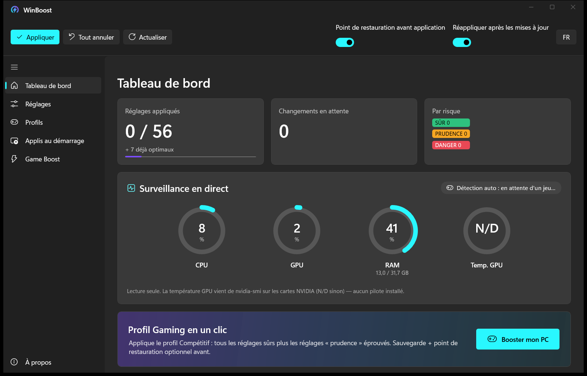

# WinBoost

**Tire le maximum de ton PC pour le jeu sur Windows 11.** / **Squeeze every frame out of Windows 11 for gaming.**

*by Corpse — v1.0.1*



WinBoost est une petite appli gratuite qui regroupe au même endroit tous les réglages Windows qui comptent vraiment pour le jeu : mode d'alimentation, mode Jeu, planification GPU, latence réseau, souris, applis en arrière-plan… Tu coches, tu cliques sur **Appliquer**, c'est fait. Et si un réglage ne te plaît pas, tu reviens en arrière en un clic.

*WinBoost is a small free app that gathers every Windows setting that actually matters for gaming in one place: power plan, Game Mode, GPU scheduling, network latency, mouse, background apps… Tick, hit **Apply**, done. Don't like a tweak? Roll it back in one click.*

---

## 🎮 À quoi ça sert ? / What is it for?

Windows 11 est réglé d'origine pour économiser l'énergie et faire plein de choses en arrière-plan — pas pour jouer. Résultat : micro-saccades, input lag, ping qui varie, Game DVR qui enregistre en douce…

WinBoost corrige ça proprement :

- **Alimentation** : mode *Performances optimales*, plus de mise en veille USB/PCIe/Wi-Fi, parking des cœurs désactivé ;
- **Mode Jeu** : mode Jeu activé, Game DVR et captures de la Game Bar coupés ;
- **GPU** : planification GPU matérielle (HAGS), optimisations des jeux fenêtrés, priorité MMCSS ;
- **Réseau** : Nagle désactivé, limitation réseau supprimée, plus de partage P2P des mises à jour ;
- **Souris & clavier** : accélération souris coupée (visée 1:1), fini la popup des touches rémanentes ;
- **Arrière-plan** : applis Store, Edge, SysMain, indexation… et un outil **Game Boost** pour fermer ce que *tu* choisis et passer ton jeu en priorité haute.

*Windows 11 ships tuned for power saving and background activity, not gaming. WinBoost fixes that cleanly: Ultimate Performance plan, Game Mode, no Game DVR, HAGS, Nagle off, raw mouse input, fewer background apps — plus a Game Boost tool to close the apps* you *pick and raise your game's priority.*

## ✨ Ce qu'il fait / What it does

- **56 réglages** dans 10 catégories, chacun avec un badge de risque : **SÛR**, **PRUDENCE**, **DANGER**.
- **3 profils** : Recommandé (sûr uniquement), Compétitif, Extrême — et un bouton **« Booster mon PC »** en un clic.
- **Sauvegarde avant chaque modification** + **point de restauration** optionnel. Tout est réversible : « Tout annuler » remet *tes* valeurs d'origine.
- **Game Boost** + **détection auto des jeux** : quand un jeu se lance, WinBoost peut le passer en priorité haute et fermer les applis que *tu* as choisies — puis tout remettre comme avant quand tu quittes.
- **Tableau de bord en direct** : jauges CPU, GPU, RAM et température GPU (cartes NVIDIA).
- **Applis au démarrage** : vois ce qui se lance avec Windows et active/désactive en un clic (réversible).
- **Réapplication automatique** après les mises à jour Windows (tâche planifiée, optionnelle).
- **Interface FR / EN**, thème sombre Fluent avec Mica.
- **Installateur** classique : WinBoost s'installe dans *Program Files*, avec raccourcis Bureau et menu Démarrer, et se désinstalle proprement.
- Un réglage qui échoue est journalisé et ignoré : **l'appli ne plante pas**.

*In short: 56 tweaks with risk badges, 3 profiles, Game Boost with automatic game detection, live CPU/GPU/RAM/GPU-temp gauges, a startup apps manager, auto-reapply after Windows updates, FR/EN UI, and a proper installer to Program Files. Everything is backed up and reversible.*

## 🛡️ Ce que WinBoost ne fera jamais / What WinBoost will never do

Pas de contournement d'anti-triche, pas de pilote noyau, pas de désactivation de Defender, pas de désactivation des protections Spectre/Meltdown. Les processus d'anti-triche (Vanguard, EAC, BattlEye, FACEIT) ne sont jamais touchés. Les réglages **DANGER** (fichier d'échange, intégrité mémoire) sont **désactivés par défaut**, hors de tous les profils, et demandent une confirmation.

*No anti-cheat bypass, no kernel drivers, no Defender killing, no Spectre/Meltdown disabling. Danger tweaks are off by default, excluded from every profile and require confirmation.*

## 🚀 Installation

Télécharge **WinBoostSetup.exe** dans les [Releases](https://github.com/PixelStack1/WinBoost/releases), lance-le, c'est tout. Windows 10 (2004+) ou 11, 64 bits.

*Grab **WinBoostSetup.exe** from [Releases](https://github.com/PixelStack1/WinBoost/releases) and run it. Windows 10 (2004+) or 11, 64-bit.*

Guide détaillé : [`INSTALL/INSTALLATION-FR.md`](INSTALL/INSTALLATION-FR.md) · [English guide](INSTALL/INSTALLATION-EN.md)

## 🔧 Compiler / Build

```powershell
powershell -ExecutionPolicy Bypass -File .\build.ps1
# -> Bureau\WinBoost\WinBoost.exe (seul fichier visible ; le runtime est à côté en fichiers cachés)
```

## 📁 Fichiers / Files

Tout est dans `%LocalAppData%\WinBoost\` : `winboost.log` (journal), `Backups\` (sauvegardes du registre), `originals.json` (valeurs d'origine pour l'annulation), `autoprofile.json` (réapplication auto).

Les réglages sont décrits dans `WinBoost/Data/settings.json` — tu peux en ajouter sans toucher au code (ou poser un `settings.json` dans `%LocalAppData%\WinBoost\` pour remplacer la liste intégrée).

---

*WinBoost — by Corpse. Utilise-le à tes risques ; crée un point de restauration avant de tester les réglages « Prudence » et « Danger ».*
